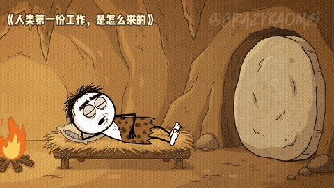
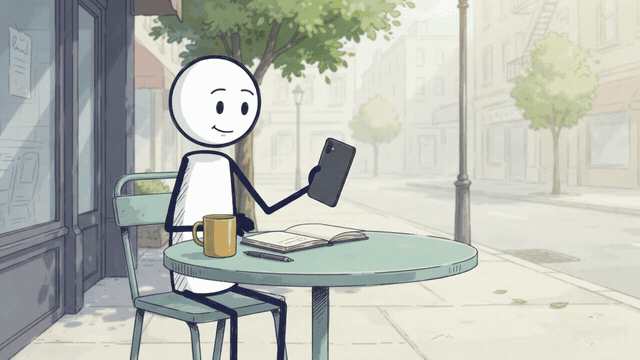
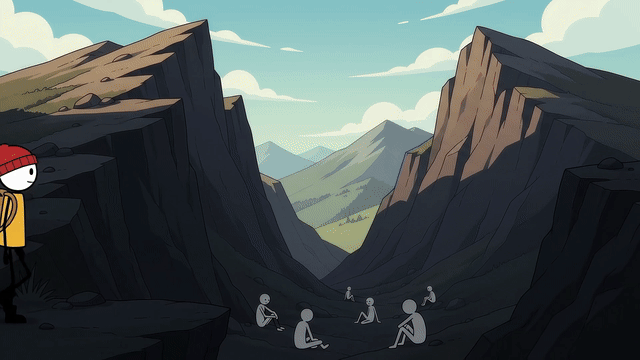
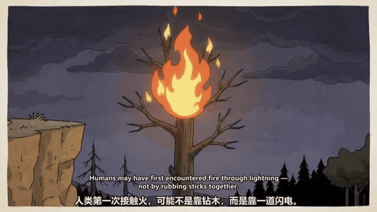
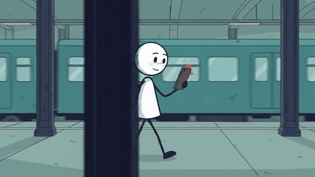

<!-- readme:hero -->

<div align="center">

[**简体中文**](README.zh-CN.md) · [English](README.en.md) · [日本語](README.ja.md) · [한국어](README.ko.md) · [Português do Brasil](README.pt-BR.md)

# 火柴人画风大全

**将任何想法变成一部高质量的、稳定画风火柴人视频。**

[](https://github.com/kaomei/stickman-video-director/stargazers)


</div>

我把全网所有热门的火柴人画风，逐个实测并整理开源出来。安装好 Skill 后，你只需要给一个话题，就能拿到动画脚本、动态分镜，以及配音和音效提示词。

**以后想做火柴人动画，来这里挑画风就够了——**适用于 **YouTube 知识讲解、TikTok、职场励志、教育科普和快节奏情感故事。**

<table width="100%">
<tr>
<td width="50%" align="center">
<strong>黑白极简</strong><br>
<a href="#style-gallery"></a>
</td>
<td width="50%" align="center">
<strong>潮酷科技</strong><br>
<a href="#style-gallery"></a>
</td>
</tr>
<tr>
<td width="50%" align="center">
<strong>史前黑色幽默</strong><br>
<a href="#style-gallery"></a>
</td>
<td width="50%" align="center">
<strong>治愈故事</strong><br>
<a href="#style-gallery"></a>
</td>
</tr>
</table>

<div align="center">

**4 大画风 · 6 种视觉方案 · 实测样片 · 免费开源**

[开始使用](#quick-start) · [查看全部画风](#style-gallery) · [完整制作教程](https://x.com/CrazyKaomei/status/2102311241046008268)

⭐ **先收藏，下次做火柴人动画不用再到处找提示词。**

</div>

<!-- readme:demos -->

<a id="style-gallery"></a>

## 全部画风一览

### 风格 1：基础黑白风

用最少的线条，把一个概念讲清楚。纯白或纯黑的画布上，人物、道具和强调色承担主要信息，适合做节奏明快的知识解说。

- **画面特点**：简洁圆头、线条肢体与统一线宽，可偶尔加入简单表情；最多三种高饱和强调色，用来区分情绪、风险或行动。抽象内容可以变成具体画面，比如把焦虑画成牢笼，把注意力画成进度条。
- **适合内容**：科学常识、心理成长、励志、自我管理、商业拆解与概念解释。
- **怎么选**：白底黑火柴人清爽直观，适合教学和日常科普；黑底白火柴人对比更强，适合悬念、冲突和情绪表达。

| 风格 1A：白底黑火柴人 | 风格 1B：黑底白火柴人 |
|:---:|:---:|
| <!-- demo:light:start --><!-- demo:light:end --> | <!-- demo:dark:start --><!-- demo:dark:end --> |
| 纯白画布 · 黑色人物 | 纯黑画布 · 白色人物 |

---

### 风格 2：现代潮酷风

红色冷帽、黄色 T 恤，是这套画风最鲜明的角色标记。既可以在干净的科技空间里讲产品，也可以走进卧室、街道和荒野，演一段有起伏的故事。

- **画面特点**：固定红帽黄衣的极简角色，搭配两种环境。2A 用纯白空间、极淡网格、悬浮玻璃界面和青蓝光效表现科技感；2B 用彩色场景、光影和空间纵深营造故事氛围。
- **适合内容**：2A 适合 AI 工具、科技产品、方法教学与功能解说；2B 适合成长经历、生活话题、冒险与励志故事。
- **怎么选**：重点是“讲清一个工具或方法”，选 2A；重点是“跟着角色经历一件事”，选 2B。

| 风格 2A：极简科技 | 风格 2B：彩色故事 |
|:---:|:---:|
|  |  |
| 纯白空间 · 极淡网格 · 青蓝微光 | 彩色场景 · 电影光影 · 叙事氛围 |

---

### 风格 3：史前手绘 / 黑色幽默

把今天的烦恼，搬回没有手机和办公室的史前世界。洞穴、兽皮、篝火和夸张表情，让职场、人性与生活里的荒诞，变成一段带反转的小故事。

- **画面特点**：粗手绘线条、白色实心头部、深色肢体、兽皮服饰和土色环境，强调角色互动、表情反应与喜剧停顿。角色按故事设计，男女老幼都可以出现，不同故事不必共用一张脸。
- **适合内容**：史前脑洞、职场讽刺、人性观察、黑色幽默、寓言与儿童英语故事。
- **怎么选**：想用一个小情节讲出“原来如此”或“怎么会这样”的反转，可以选这一风格；尤其适合把现代关系放进原始部落，做出熟悉又意外的笑点。

| 案例 1：《人类的第一份工作是怎么来的？》 | 案例 2：《人类第一次发现火源》 |
|:---:|:---:|
|  |  |
| 史前故事 · 职场反转 | 火源主题 · 粉丝作品 |

**粉丝案例：《人类第一次发现火源》** — 由粉丝 [X：@monixin888](https://x.com/monixin888/status/2109651037850325112) 使用 WorkBuddy 调用本 Skill 制作。

---

### 风格 4：治愈故事风

一只舍不得用的杯子，一条忍不住秒回的消息，一个终于留给自己的下午。让极简角色走进彩色的日常场景，用动作、表情和镜头讲普通人能共鸣的小事。

- **画面特点**：白色实心圆头与细长躯干、深色细肢体和自然的小表情，搭配完整的 2D 卡通环境。全景交代地点，近景捕捉犹豫或释然，跟拍带着角色继续向前。
- **适合内容**：生活共鸣、心理成长、人际关系、温暖故事、习惯养成与儿童英语。
- **怎么选**：想让观众从一个具体生活片段里认出自己，可以选这一风格。色彩和光影随主题变化，既能表达温暖，也能讲焦虑、疲惫和重新出发。

| 案例 1：通勤路上的消息焦虑 | 案例 2：把时间留给自己 |
|:---:|:---:|
|  |  |
| 地铁站 · 行走跟拍 · 情绪近景 | 露天咖啡座 · 暖光树影 · 日常动作 |

<!-- readme:advantages -->

## 从一段文案到一支视频

把主题、文章或笔记交给 Skill，先拿到导演提案，确认后再输出 Gemini Omni Flash 视频提示词。你负责选内容、挑效果，Flow 负责生成片段，最后用剪映完成字幕和剪辑。

| 你不用从零想的事 | Skill 帮你完成 |
|---|---|
| **文案怎么讲** | 改写强开场、递进解释和结尾回扣，并配上英文旁白与参考翻译。 |
| **画面怎么动** | 规划动作、道具、视觉隐喻、运镜、转场与音效；通常每 2–3 秒安排一次视觉变化。 |
| **多段怎么接** | 设计动作、道具和换场接口，在每条提示词里保持人物、画风与声线；背景可以随着故事主动更换。 |
| **横竖屏怎么排** | 根据画幅重新安排人物位置、镜头路径与画面空间。 |
| **哪里可以改** | 先看导演提案，不满意就调整，确认后才输出最终提示词。 |

知识与观点类内容按“开场钩子 → 打破预期 → 解释机制 → 核心结论 → 结尾回扣”组织；史前故事更注重“铺垫 → 升级 → 反转”，不硬套同一种结尾。

<!-- readme:platforms -->

## 做什么内容，发到哪里

- **知识与故事账号**：历史、商业、科普、心理成长，用不露脸的动画讲解。
- **英语学习内容**：英文旁白配后期双语字幕，做儿童英语、生活短剧或知识精读。
- **品牌与内容服务**：产品解说、教育短片、客户定制动画；也可以围绕原创账号探索平台分成与品牌合作。

YouTube Shorts、TikTok、Instagram Reels 适合竖屏短片，YouTube 和 B 站也可以做横屏解说。

| 比例 | 适合平台 | 构图重点 |
|---|---|---|
| `9:16` | YouTube Shorts、TikTok、Instagram Reels、抖音、小红书 | 纵向动作、中央主体、手机画面安全区 |
| `16:9` | YouTube、B 站、横屏教育视频 | 横向调度、场景展开、左右对比 |

时长默认 **60 秒**，也可以选 30 秒、90 秒、3 分钟等 10 秒整数倍。按每段约 10 秒规划：30 秒输出 3 条提示词，60 秒输出 6 条。

<!-- readme:workflow -->

## 从文案到视频，五步走

1. **给内容**：粘贴文案、文章、笔记，或直接说一个主题。
2. **选设置**：确定画幅、时长和画风；风格 1 再选白底或黑底，也可以指定男声、女声和表达基调。
3. **看提案**：检查英文旁白、参考翻译、画面、镜头、转场、BGM 与音效，不满意就改。
4. **确认后拿提示词**：获得对应数量的独立 Gemini Omni Flash 提示词。
5. **生成并剪辑**：把提示词分别交给视频模型，再拼接片段、添加字幕，完成成片。

换主题、画幅、风格或其他全局设置后，会重新整理提案，再请你确认。缺少画幅或画风时会先询问；没填时长则默认一分钟。

<!-- readme:output -->

## 你会拿到什么

- **导演提案**：标题、基调、英文旁白与参考翻译，以及按时间排列的画面设计。
- **视频提示词包**：每段都有明确动作节拍、人物与道具描述、声音设定、台词和衔接要求。
- **后期建议**：字幕、BGM、音效和拼接说明。生成画面默认不带文字，字幕后期添加。

Skill 负责提案和提示词，视频由你在 Flow 等生成工具中制作；无需为 Skill 配置 API 或 MCP。

<!-- readme:install -->

<a id="quick-start"></a>

## 安装与使用

下面是 Codex 的安装方式：

```bash
git clone https://github.com/kaomei/stickman-video-director.git
cd stickman-video-director
cp -R skills/directing-stickman-videos "${CODEX_HOME:-$HOME/.codex}/skills/"
```

重启 Codex 后，输入：

```text
$directing-stickman-videos

主题：别让“想太多”困住你。
30 秒，16:9，黑底白火柴人，美式男声。
先给我导演提案，确认后再输出视频提示词。
```

也可以试试：

- “一分钟讲清黑洞，白底黑火柴人，9:16，活泼女声。”
- “30 秒讲希望，风格 2A，16:9，低沉男声。”
- “《谁偷了我的香蕉？》，风格 3，30 秒，16:9，适合儿童学英语。”
- “为什么总忍不住秒回？风格 4 治愈故事风，30 秒，16:9，美式男声，办公室→地铁站→露天咖啡座。”

## 提示词怎么用？

在 [Google Flow](https://flow.google.com/) 等支持对应模型的工具中，按顺序提交每段提示词，检查画面与配音后再拼接。字幕可以最后统一添加。

第一次做，可以跟着这篇[完整制作教程：选题、脚本、Flow 生成与剪映成片](https://x.com/CrazyKaomei/status/2102311241046008268)跑一遍。Flow 的具体操作见[使用教程](https://x.com/CrazyKaomei/status/2093893997223923822?s=20)。Skill 免费开源，视频生成的费用和可选模型以平台当前界面为准。

<!-- readme:reliability -->

## 使用小贴士

- 人物、道具和旁白设定按整支视频统一；需要换声音时，先在提案里确定。
- 发现某段人物、道具或声音明显偏离时，针对该段调整和复测，不用重做所有片段。
- 文案可以改得更有吸引力，但不凭空添加事实、数据或产品效果。

## 下一种火柴人，你来点

想看哪种画风？到 [Issues](https://github.com/kaomei/stickman-video-director/issues) 留下参考和想做的主题。下面这些正在计划中，尚未上线：

- **虚实融合场景** — 继续探索 2D 火柴人与更丰富环境的搭配。
- **风格 5：讲台解说** — 黑板互动与知识讲解。
- **风格 6：手绘绘本** — 童话、寓言与儿童故事。
- **风格 7：涂鸦打斗** — 动作短片与连招对决。
- **风格 8：双人情景喜剧** — 对话、互怼与日常反转。
- **风格 9：卡牌闯关** — 升级、打怪与游戏叙事。

<!-- readme:contribute -->

## 你的作品，也可以成为下一个案例

欢迎提交作品、想看的画风或具体问题。分享案例时请附上主题、所用风格与作者链接，方便展示和署名。

⭐ **点个 Star，把这份画风大全收进工具箱。新画风会继续更新，也欢迎来交作业。**

我是[烤妹儿](https://x.com/CrazyKaomei)，会继续实测新画风、分享制作教程，也把大家做出的好作品放进来。

## 许可证

MIT
